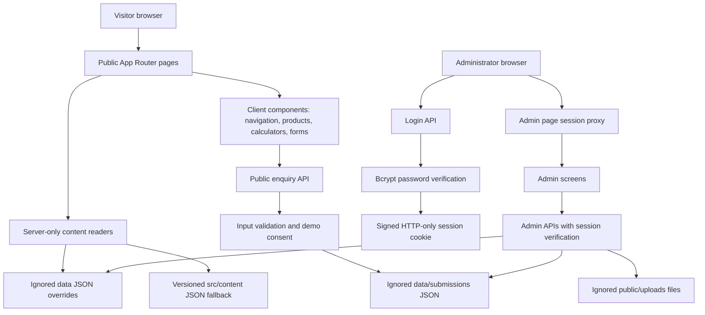

# Mero Sahakari

A warm, responsive website demo for a cooperative in Nepal. Mero Sahakari means “my cooperative”. The site pairs approachable English content and Nepali brand phrases with forest-green colours, self-hosted typography, a dimensional logo and illustrated Nepali characters.

**This is a fictional organisation.** People, branch locations, financial products, rates and articles are illustrative. The website does not accept deposits, issue loans, create financial accounts or provide real membership. Use invented details when trying the enquiry forms.

## What is included

- Responsive public pages for savings and loans, cooperative information, board members, management, the chairperson’s message, branches, articles and contact.
- Product category selection and individual product pages.
- Loan repayment and fixed deposit calculators with immediate feedback and zero-interest support.
- Sample membership and contact enquiries, with browser and server validation, pending, error and success states.
- A password-protected administration area for products, rates, news, branches, team members, site settings, credentials and enquiry review.
- Server-rendered editorial content. Administrator changes appear on the next public page request.
- Local WebP artwork and local variable fonts. No runtime image CDN or external font service is required.
- Keyboard focus states, a skip link, labelled forms, responsive navigation, semantic landmarks and reduced-motion support.

The interface is primarily English. Nepali phrases use a dedicated Devanagari font. There is no full-site language switch.

## Requirements

- Node.js 22 or newer. Node.js 24 is recommended.
- npm, with the committed `package-lock.json`.
- A writable project directory for `data/` and `public/uploads/` if using forms or the admin tools.
- A single persistent Node.js process for the included JSON storage implementation.

The stack is Next.js App Router, React, TypeScript and plain CSS. Lucide provides interface icons; `jose` handles signed sessions; `bcryptjs` verifies administrator passwords. ESLint, Prettier and Node’s built-in test runner provide development checks.

## Quick start

```bash
npm ci
npm run dev
```

Open [localhost:3000](http://localhost:3000).

Public pages and sample enquiries work without environment variables. If `data/` does not exist, editorial content falls back to the committed files in `src/content/`. Runtime directories are created when needed.

### Administrator setup

1. Copy `.env.example` to `.env.local`.
2. Generate a strong session secret:

   ```bash
   node -e "console.log(require('node:crypto').randomBytes(32).toString('hex'))"
   ```

3. Set that value as `AUTH_SECRET` in `.env.local`.
4. Generate a password hash. This interactive command avoids including the password in shell history:

   ```bash
   node --input-type=module -e 'import bcrypt from "bcryptjs"; import { createInterface } from "node:readline/promises"; const prompt = createInterface({ input: process.stdin, output: process.stdout }); const password = await prompt.question("New admin password (visible while typing): "); prompt.close(); if (password.length < 12) throw new Error("Use at least 12 characters"); console.log(await bcrypt.hash(password, 12));'
   ```

5. Add the generated hash to `ADMIN_USERS`, preserving the single quotes around the JSON value:

   ```dotenv
   AUTH_SECRET=your_generated_secret_of_at_least_32_characters
   SESSION_EXPIRY_HOURS=8
   ADMIN_USERS='[{"username":"site-admin","passwordHash":"PASTE_GENERATED_BCRYPT_HASH","role":"admin"}]'
   ```

6. Restart the server and visit `/admin/login`.

There are no built-in public credentials. `ADMIN_USERS` bootstraps `data/admins.json` on the first sign-in attempt when no credential file exists. After bootstrapping, use the Credentials screen to change passwords. Changing `ADMIN_USERS` does not overwrite existing stored accounts. Administrator password recovery requires a server operator to back up and remove the local `data/admins.json`, then restart with the intended bootstrap configuration.

Sessions use an HTTP-only, SameSite Strict cookie, with Secure enabled in production. `SESSION_EXPIRY_HOURS` accepts 1 to 168 hours and defaults to 8. The `admin` role can manage credentials; `editor` accounts can manage content and change their own password.

## Commands

| Command                | Purpose                                                   |
| ---------------------- | --------------------------------------------------------- |
| `npm run dev`          | Start local development with Webpack                      |
| `npm run build`        | Create the production build                               |
| `npm start`            | Serve the production build                                |
| `npm run lint`         | Check source and test scripts with ESLint                 |
| `npm run typecheck`    | Check TypeScript without writing JavaScript               |
| `npm test`             | Check calculator maths and file storage behavior          |
| `npm run check`        | Run lint, type checking and tests                         |
| `npm run format`       | Format maintained source, configuration and this README   |
| `npm run format:check` | Check formatting without changing files                   |
| `npm audit`            | Check the dependency lockfile against registry advisories |

Use `npm run dev -- --port 3001` or `npm start -- --port 3001` when port 3000 is occupied. Build before running a type check on a fresh checkout if generated Next.js route types are not yet available.

## File system architecture

```text
mero-sahakari/
├── public/
│   ├── fonts/                    # Local fonts and their OFL licences
│   ├── images/
│   │   ├── brand/                # Dimensional logo and favicons
│   │   ├── team/                 # Six fictional character portraits
│   │   ├── news/                 # Unique editorial illustrations for each article
│   │   ├── hero-cooperative.webp  # Savings, home, education and farming illustration
│   │   └── community.webp        # Cooperative story illustration
│   └── uploads/                  # Ignored runtime uploads
├── scripts/
│   ├── calculators.test.cjs      # Financial estimate boundary checks
│   └── store.test.cjs            # Storage fallback and concurrency checks
├── src/
│   ├── app/
│   │   ├── (site)/               # Public routes and shared public layout
│   │   │   ├── about/            # Introduction, board, management, chairperson
│   │   │   ├── apply/            # Sample membership and service enquiry
│   │   │   ├── branches/
│   │   │   ├── contact/
│   │   │   ├── news/[id]/
│   │   │   ├── products/[category]/[slug]/
│   │   │   └── page.tsx          # Home page
│   │   ├── admin/                # Separate administration layout and screens
│   │   ├── api/
│   │   │   ├── admin/            # Authenticated content, upload and credential APIs
│   │   │   ├── auth/             # Login, logout and session APIs
│   │   │   └── public/           # Sample contact and application APIs
│   │   ├── layout.tsx            # Document shell and shared metadata
│   │   ├── error.tsx             # Recoverable page error
│   │   ├── not-found.tsx
│   │   └── robots.ts
│   ├── components/layout/        # Brand, header, footer and page introduction
│   ├── content/                  # Versioned, non-sensitive demo seed JSON
│   ├── features/
│   │   ├── calculator/           # Loan and deposit interaction
│   │   ├── forms/                # Shared enquiry form
│   │   ├── products/             # Explorer, card and icon mapping
│   │   └── team/                 # Illustrated team grid
│   ├── lib/
│   │   ├── server/               # Content reads, storage, auth and form validation
│   │   └── utils.ts              # Shared formatting and calculator maths
│   ├── styles/                   # Public design tokens/styles and admin styles
│   ├── types/                    # Shared editorial content types
│   └── proxy.ts                  # Admin-page authentication boundary
├── data/                         # Ignored, writable content overrides and submissions
├── .env.example                  # Safe configuration template
├── eslint.config.mjs
├── next.config.js                # Framework and HTTP security headers
├── package.json
├── package-lock.json
├── tsconfig.json
└── README.md
```

Next.js route groups such as `(site)` organise the source without changing public URLs. Public navigation and footers are excluded from administrator screens.

## System architecture



### Content flow

1. A server-rendered page calls a typed reader in `src/lib/server/content.ts`.
2. The store first tries a matching file under `data/`.
3. If no runtime override exists, it reads `src/content/<name>.json`.
4. Administrator saves create or update the runtime override. Committed seed files remain unchanged.
5. Public content pages use dynamic rendering so subsequent requests reflect saved changes.

The store serializes writes per file and atomically replaces files. Sample enquiry append operations perform their read and write inside the same lock. These locks exist within one process; they are not a distributed database. Simultaneous editorial edits use last-save-wins semantics.

### Enquiry flow

`POST /api/public/apply` and `POST /api/public/contact` accept JSON. They validate field types and lengths, Nepali-format phone numbers, optional email, service choices and explicit demo consent. A hidden field rejects basic form spam. Valid sample submissions are saved to ignored runtime files and appear under Admin → Demo enquiries. Empty submission stores are treated as empty lists on a fresh checkout.

No email, SMS, payment gateway or external CRM is connected. Success means the demo server saved the sample enquiry. It does not promise a real callback or membership.

### Authentication boundary

The proxy guards administrator page navigation. Every protected API separately verifies the signed session, so bypassing a page redirect does not grant API access. Credential-management endpoints also check the account role. The session configuration is isolated from file storage and content code.

## Customisation

### Branding and copy

- Edit `src/components/layout/Brand.tsx`, the header, footer and shared metadata for a client-specific identity.
- Set palette and typography tokens in `src/styles/globals.css`.
- Replace logo files under `public/images/brand/` and update their image dimensions if needed.
- Update seed JSON in `src/content/` for a new demo. Existing runtime overrides take precedence; back them up and remove only the intended override to see seed changes.
- Public page narratives live in their route files; editable products, rates, team details, articles, locations and contact information live in content JSON.

The settings screen updates the contact details shown on the contact and branch pages. The primary brand name, navigation copy, metadata and homepage narrative are intentionally maintained in source. Product rates and the full rate table are separately editable; keep them consistent when preparing a client demonstration.

### Imagery and fonts

The object-led cooperative hero, cooperative story scene, article illustrations, logo and portraits were generated for this demo. Each article has its own image and description, shared consistently between its preview and article page. The hero and cooperative story use separate illustrations. They depict fictional people. The portraits use an animated-film visual style; they are still images with a restrained hover response, rather than looping videos. Local WebP files keep their download sizes small. The hero uses explicit dimensions and priority loading; secondary images are lazy loaded.

DM Sans and Noto Sans Devanagari are distributed under the SIL Open Font License. Their required licence files are included in `public/fonts/`. Keep those notices when redistributing the font assets.

### Calculator assumptions

The loan calculator uses a monthly reducing balance:

```text
r = annualRate / 1200
monthlyPayment = principal × r / (1 - (1 + r)^(-months))
```

At zero interest, the payment is `principal / months`. The fixed deposit calculator uses simple interest: `principal × annualRate / 100 × months / 12`.

Estimates exclude fees, insurance and taxes. They do not apply a specific provider’s compounding policy, eligibility rules or rounding schedule. They are demonstrations, not financial offers.

## Deployment

```bash
npm ci
npm run check
npm run build
npm start
```

Use a persistent Node.js host or container with one app process and durable writable storage. Preserve `data/` and `public/uploads/` across releases. Keep `src/content/` present in the deployed application because the file store reads its fallback JSON at runtime. Set the administrator environment variables on the host, never in committed source. Set `NEXT_PUBLIC_SITE_URL` to your deployed origin so social preview images use the correct absolute URL.

A static export cannot run the admin APIs or enquiries. Ephemeral or read-only serverless filesystems cannot reliably preserve this implementation’s edits and submissions. For such platforms, replace the JSON store with a durable database and uploads with object storage. Multiple app instances also require shared database storage rather than the included process-local locks.

For an actual cooperative, complete the organisation-specific content, privacy and operational setup before collecting real member data. Add deployment-level request throttling, backups and monitoring suitable for the expected traffic. The sample has a basic honeypot, not a distributed abuse-prevention system.

## Public repository hygiene

The repository keeps application source, seed data, assets, dependency manifests, development checks and this README. `.gitignore` excludes:

- Environment secrets and local credential stores.
- Writable content overrides, form submissions and uploaded files.
- Agent configuration, generated research, working notes and design documentation.
- Screenshots, tool output, build products, caches and local editor settings.
- Markdown documents other than this README.

Ignoring a file does not remove an already tracked copy. When adapting an existing repository, remove those files from the Git index while retaining local copies. This project’s cleanup handles that for existing runtime data and internal documents. Git history is not rewritten; review any previously committed credentials before publishing an existing history, and replace credentials that were exposed.

## Troubleshooting

| Symptom                                    | What to check                                                                                                                             |
| ------------------------------------------ | ----------------------------------------------------------------------------------------------------------------------------------------- |
| `npm ci` fails                             | Confirm Node.js 22+ and use the committed lockfile. Ensure registry access is available.                                                  |
| Port 3000 is already used                  | Pass `--port 3001` to the development or start command.                                                                                   |
| `Could not find a production build`        | Run `npm run build` before `npm start`.                                                                                                   |
| Administrator login fails                  | Check `AUTH_SECRET`, the exact username, the bcrypt hash and bootstrap JSON quoting. Restart after editing environment variables.         |
| New `ADMIN_USERS` is ignored               | A local `data/admins.json` already exists. Use Credentials, or follow the operator recovery procedure above.                              |
| Session expires immediately                | Check the host clock and cookie settings. Production Secure cookies require HTTPS.                                                        |
| An enquiry returns validation errors       | Use invented details with a valid-format Nepali phone number, complete required fields and confirm demo consent.                          |
| Enquiries or edits fail to save            | Check filesystem permissions and persistent storage for `data/`. A read-only deployment cannot use the JSON store.                        |
| Seed edits are not visible                 | A matching `data/<name>.json` override takes precedence. Back it up, then remove only that override or edit it through the administrator. |
| Uploaded images disappear after deployment | Preserve `public/uploads/` on durable storage or switch uploads to object storage.                                                        |
| Team image is missing                      | Verify the URL is local and the file exists. The supplied portraits are in `public/images/team/`.                                         |
| A page is missing                          | Check the URL and whether its product or article still exists. Category and slug must both match.                                         |
| Old brand styling appears locally          | Restart development and refresh the page. If the build cache is stale, stop the server, remove `.next/`, and rebuild.                     |

## Validation

The final production dependency audit reported zero vulnerabilities. The full audit also reports moderate advisories in development-only ESLint dependencies; resolving them currently requires upstream dependency updates. These packages are not part of the production runtime.

`npm test` covers reducing-balance calculations, zero-interest handling, invalid calculator inputs, simple deposit interest, seed fallback, fresh submission stores, serialized concurrent appends, failed-write recovery and store path restrictions. TypeScript and ESLint check the application separately. Browser checks should include desktop and mobile navigation, product categories, both calculators, enquiries and administrator permissions before adapting or deploying the template.

## Licensing

Font licences are included with their assets. Dependencies retain their respective licences. This repository does not assign a blanket open-source licence to the application; add the licence appropriate to your intended distribution before offering reuse rights to others.
